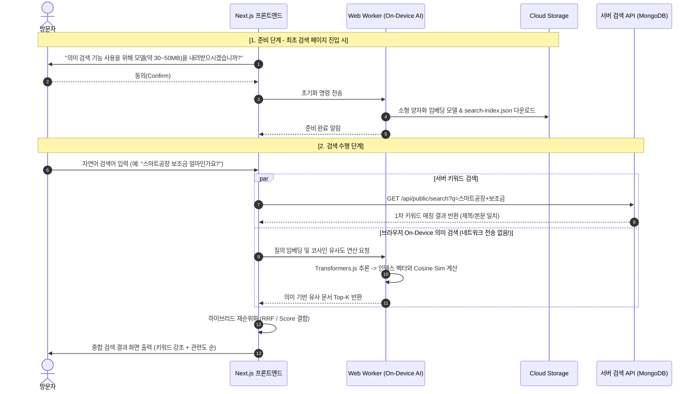

# On-Device 의미 검색 엔지니어링 가이드

- **문서 참조**: `docs/작업지시서.md` §6 (On-Device 의미 검색 설계), §9 (WBS T-17~T-20)
- **핵심 목표**: 사용자 질의와 검색어를 외부 서버나 유료 LLM API로 전송하지 않고, **방문자의 기기(브라우저) 내에서 온디바이스 AI로 의미 검색을 수행**하여 개인정보를 원천 보호하고 품질을 극대화한다.
- **원천 금지 사항**: 
  - 외부 상용 LLM(OpenAI, Claude, 외부 클라우드 임베딩 API 등)으로의 질의 전송 일체 금지.
  - 별도의 AI 챗봇/대화형 도우미 인터페이스 구현 금지.

---

## 1. On-Device 검색 처리 흐름 (시퀀스)



---

## 2. 세부 컴포넌트 규격

### 2-1. 임베딩 모델 및 인덱스 파이프라인
1. **모델 규격**: Transformers.js 호환 ONNX 양자화 모델 (예: `bge-small-ko-v1.5-q8` 또는 `all-MiniLM-L6-v2-q8`, 용량 30~45MB).
2. **사전 계산 인덱스 (`search-index.json`)**:
   - 관리자가 게시물(공지, 사업, 자료 등)을 생성/수정할 때 Cloud Run Job 또는 서버 백그라운드 태스크가 제목·요약·본문의 임베딩 벡터를 미리 추출하여 GCS에 `search-index.json`으로 배포.
   - 포맷:
     ```json
     [
       {
         "id": "post-670...",
         "type": "program",
         "title": "2026 AI 스마트팩토리 고도화 지원사업",
         "slug": "smart-factory-2026",
         "vector": [0.012, -0.045, ...]
       }
     ]
     ```

### 2-2. Web Worker 구현 지침
- 브라우저 메인 스레드의 UI 렌더링을 차단하지 않도록 전용 `Worker` 스레드에서 추론을 실행한다.
- `postMessage` 인터페이스:
  - `INIT`: 모델 가중치 및 인덱스 파일 fetch, 캐싱(CacheStorage API).
  - `SEARCH`: 질의 문자열 수신 → 토큰화 → 벡터 변환 → Cosine Similarity 연산 → Top 20 문서 반환.

### 2-3. 하이브리드 재순위화 (RRF: Reciprocal Rank Fusion)
- 키워드 순위와 벡터 유사도 순위를 RRF 수식으로 결합:
  $$RRF\_Score(d) = \frac{1}{60 + Rank_{keyword}(d)} + \frac{1}{60 + Rank_{vector}(d)}$$
- 오타, 동의어, 질문형 질의에 대해서도 높은 재현율과 정확도를 동시에 보장.

### 2-4. 무손실 폴백 (Graceful Fallback)
- 사용자가 모델 다운로드 안내 모달에서 거부(Cancel)를 누르거나, 브라우저가 Web Worker/WASM을 지원하지 않는 경우:
  - 에러 없이 **순수 MongoDB 서버 키워드 검색** 모드로 즉시 동작.
  - 검색창 우측에 `[일반 검색 모드]` 뱃지 표시 및 언제든 활성화할 수 있는 토글 제공.

---

## 3. 격리 검증 및 E2E 테스트 표준

- **Playwright 네트워크 감시 테스트 (WBS T-20)**:
  - 온디바이스 검색 수행 시 브라우저가 발생하는 모든 네트워크 요청(Request)을 가로채 검사한다.
  - 허용 도메인: 자체 오리진 `/api/public/search`, 모델 파일 및 인덱스를 호스팅하는 GCS CDN 버킷 URL.
  - **차단 및 불합격 조건**: `api.openai.com`, `anthropic.com`, `gemini.google.com` 등 외부 LLM 엔드포인트로의 요청이 단 1건이라도 발생하면 즉시 테스트 실패(Fail) 처리.
