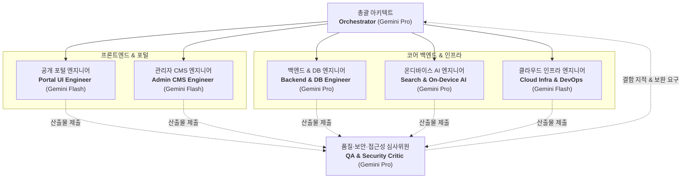

# 미래스마트산업진흥원 안내 사이트 구축 — 하네스 엔지니어링 헌장

- **프로젝트명**: 미래스마트산업진흥원 안내 사이트 구축
- **기준 사양서**: [`docs/작업지시서.md`](file:///apps/ex_project_InstituteofFutureSmartIndustry/docs/작업지시서.md) (문서 버전: **v1.2**, 작성일: 2026-10-14)
- **성격**: 기관 소개·사업·알림·자료를 안내하는 **정보 제공형 공공 포털** + 비개발자 운영자용 **관리자 CMS**
- **확정 기술 스택**: React + Next.js (App Router) + TypeScript + Tailwind CSS + MongoDB (GCP GCE 자체 운영) + Google Cloud (Cloud Run, VPC, GCS)

---

## 1. 프로젝트 6대 절대 가드레일 (Strict Invariants)

모든 에이전트는 아래 6대 원칙을 절대적으로 준수하며, 위배되는 코드나 아키텍처를 작성하지 않는다:

1. **AI 안내 도우미(챗봇/RAG/LLM 생성) 일체 제외**:
   - 대화형 챗봇, LLM 답변 생성, RAG 파이프라인은 본 프로젝트 범위에서 명시적으로 제외 확정됨 (§1.3).
2. **On-Device 의미 검색만 적용 (외부 API 유출 0건)**:
   - 검색어 및 질의를 외부 상용 LLM API(OpenAI, Claude, 클라우드 임베딩 API 등)로 절대 전송하지 않음 (§1.1, §6).
   - 브라우저 Web Worker + Transformers.js 소형 모델로 로컬에서만 임베딩/유사도 연산 수행.
3. **사업 신청·접수·결제 기능 원천 배제**:
   - 사업안내 페이지는 **정보 안내 전용**이며, 온라인 접수/신청 폼, 신청하기 버튼은 일체 구현하지 않음 (§1.3, §4.4).
   - 필요 시 외부 공식 링크(`target="_blank"`)만 선택 제공.
4. **MongoDB GCP GCE 자체 운영 (Atlas 금지 & VPC 격리)**:
   - MongoDB Atlas SaaS를 사용하지 않고, **GCP Compute Engine VM에 직접 설치·운영** (§5.1, §5.3).
   - 외부 공인 IP 미할당(No Public IP), 사설 서브넷(27017) 내부 통신, Serverless VPC Access 커넥터 연동, 매일 새벽 GCS 일일 자동 백업 스크립트 구축.
5. **관리자 직접 입력 인증 (Google OAuth 배제)**:
   - 구글 소셜 로그인을 사용하지 않고, **아이디/비밀번호 직접 입력 방식** 확정 (§4.6, §7.1).
   - 로그인 식별자는 **사용자명(`username`) 및 기관 이메일(`email`)** 입력을 모두 지원.
   - Argon2id / bcrypt 해싱, 5회 연속 실패 시 15분 계정 잠금, IP 레이트리밋, HttpOnly/Secure/SameSite=Strict 세션 쿠키 격리.
6. **환경 중요 변수 `.env` 엄격 관리 (코드 내 디폴트값 전면 금지)**:
   - `MONGODB_URI`, `SESSION_SECRET`, `INITIAL_ADMIN_*` 등 모든 중요 환경 변수는 반드시 `.env` 파일(운영: Secret Manager)을 통해서만 관리.
   - 코드베이스(`src/`, `infra/`, 스크립트) 내 `process.env.XXX || 'default'` 형태의 대체값(Fallback) 및 하드코딩된 자격증명/URI/시크릿 작성 일체 금지.
   - 필수 환경변수 누락 또는 규격 미달 시 즉시 명시적 예외(`CRITICAL CONFIG ERROR`)를 발생시켜 비인가 실행을 원천 차단.
   - 클라이언트 번들에 관리자 비밀번호나 테스트 계정 정보를 하드코딩 노출하지 않음.

---

## 2. 전문 에이전트 팀 아키텍처 & 모델 티어링 맵

Google Antigravity / Gemini의 특성을 고려하여 7대 전문 에이전트 풀을 구성하고 업무 성격에 따른 모델 티어를 배정한다:

### 에이전트 역할 및 모델 티어 배정

| 에이전트 | 모델 티어 | 주 임무 및 책임 (R&R) | 연계 스킬 및 도구 |
| :--- | :--- | :--- | :--- |
| **Orchestrator** | **Gemini Pro** | WBS(T-01~T-25) 일정 조율, 요구사항 무결성 검증, 에이전트 간 작업 분배 | `harness`, `ralph-loop` |
| **Portal UI Engineer** | **Gemini Flash** | 반응형 메인(배너/퀵링크/새소식), 소개, 사업안내(신청배제), 자료실 화면 구현 | `smart-industry-cms` |
| **Admin CMS Engineer** | **Gemini Flash** | 직접 로그인, 대시보드, 콘텐츠 CRUD, 마크다운 에디터, 대체텍스트 검증 | `smart-industry-cms` |
| **Backend & DB Engineer** | **Gemini Pro** | Next.js Route Handlers, Server Actions, Mongoose 스키마, 직접 인증/세션 | `architecture-mongodb-gcp`, `admin-security` |
| **Search & On-Device AI** | **Gemini Pro** | Web Worker Transformers.js 온디바이스 검색, RRF 하이브리드 재순위화, 모델 동의 모달 | `on-device-search` |
| **Cloud Infra & DevOps** | **Gemini Flash** | GCP GCE VM MongoDB 설치, VPC 커넥터, 일일 자동 백업 스크립트, Cloud Run 배포 | `gcp-mongo-ops` |
| **QA & Security Critic** | **Gemini Pro** | 트래픽 외부 유출 0건 Playwright E2E 검증, KWCAG 2.2 웹 접근성, NoSQL/XSS 보안 점검 | `admin-security`, `on-device-search` |

---

## 3. 하네스 규칙 및 스킬 라우팅 맵 (점진적 공개)

필요한 작업 단계에서 관련 세부 가이드를 온디맨드로 참조한다:

- [smart-industry-domain.md](file:///apps/ex_project_InstituteofFutureSmartIndustry/.agents/rules/smart-industry-domain.md): 기관 개요, IA 사이트맵, 화면별 요구사항, 데이터 모델 스키마
- [architecture-mongodb-gcp.md](file:///apps/ex_project_InstituteofFutureSmartIndustry/.agents/rules/architecture-mongodb-gcp.md): GCE VM MongoDB 자체 운영, VPC 격리, Cloud Run, 일일 백업(GCS)
- [on-device-search.md](file:///apps/ex_project_InstituteofFutureSmartIndustry/.agents/rules/on-device-search.md): Web Worker Transformers.js 로컬 의미검색, 외부 트래픽 0건 격리 검증
- [admin-security.md](file:///apps/ex_project_InstituteofFutureSmartIndustry/.agents/rules/admin-security.md): 직접 자격증명 인증, 5회 실패 잠금, 세션 쿠키, 감사로그, KWCAG 2.2 웹 접근성
- [git-workflow.md](file:///apps/ex_project_InstituteofFutureSmartIndustry/.agents/rules/git-workflow.md): 업무 단위별 원자적 Git Commit 규약 및 태그 컨벤션
- [harness-engineering.md](file:///apps/ex_project_InstituteofFutureSmartIndustry/.agents/rules/harness-engineering.md): 하네스 엔지니어링 헌장 및 5대 품질 패턴

---

## 4. WBS 및 공정 단계 (8주 공정)

- **P0. 기획/화면설계 및 IA 확정** (3일)
- **P1. 디자인 시스템 & 시안 확정** (7일)
- **P2. 인프라/기반 (GCP GCE MongoDB 자체구축 & Next.js 골격 & 직접인증)** (12일) [T-01~T-06]
- **P3. 공개 포털 (메인/GNB/소개/사업/알림 화면)** (14일) [T-07~T-11]
- **P4. 관리자 CMS (CRUD/업로드/로그 구현)** (14일) [T-12~T-16]
- **P5. 검색/AI (On-Device 의미검색 구축 & E2E 트래픽 검증)** (7일) [T-17~T-20]
- **P6. 종합 QA (접근성/보안/성능/부하 테스트)** (7일) [T-21~T-23]
- **P7. 배포/인수인계 (Cloud Run 배포 & 매뉴얼 인계)** (3일) [T-24~T-25]

---

## 5. 하네스 변경 이력 (Harness Changelog)

| 일자 | 버전 | 변경 내용 | 대상 파일 / 규칙 |
| :--- | :--- | :--- | :--- |
| 2026-10-14 | **v3.1.0** | **환경 변수 `.env` 엄격 관리 및 코드 내 디폴트값 전면 금지 헌장 반영**: ① **6대 절대 가드레일 확장**: 환경변수 fallback 금지 및 `.env` 중앙화(`src/lib/config/env.ts`) 강제 ② **관리자 인증 식별자 고도화**: 사용자명(`username`) 및 이메일(`email`) 복합 로그인 지원 ③ **클라이언트 번들 보안**: 로그인 UI에서 하드코딩된 자격증명/디폴트 비밀번호 노출 원천 차단 ④ **환경 변수 템플릿 표준화**: `.env.example` 형상 관리 등록 및 `.gitignore` 예외 반영 ⑤ `GEMINI.md`, `AGENTS.md`, `.agents/rules/*` 전면 동기화 | `GEMINI.md`, `AGENTS.md`, `admin-security.md`, `architecture-mongodb-gcp.md`, `.env.example` |
| 2026-10-14 | **v3.0.0** | **`docs/작업지시서.md` (v1.2) 반영 워크스페이스 하네스 프롬프트 전면 개편**: ① eCare24 이전 프로젝트 유물 완전 제거 ② 미래스마트산업진흥원 포털 + 관리자 CMS 도메인 규칙 신설 (`smart-industry-domain.md`) ③ GCE VM MongoDB 자체 운영 & VPC & GCS 백업 규칙 신설 (`architecture-mongodb-gcp.md`) ④ On-Device 의미 검색 및 외부 트래픽 격리 규칙 신설 (`on-device-search.md`) ⑤ 직접 입력 인증(Argon2id, 5회 실패 잠금) 및 KWCAG 2.2 규칙 신설 (`admin-security.md`) ⑥ 7대 전문 에이전트 풀 및 신규 스킬 3종(`smart-industry-cms`, `on-device-search`, `gcp-mongo-ops`) 배치 | `GEMINI.md`, `AGENTS.md`, `.agents/rules/*`, `.agents/skills/*`, `plugin.json` |
