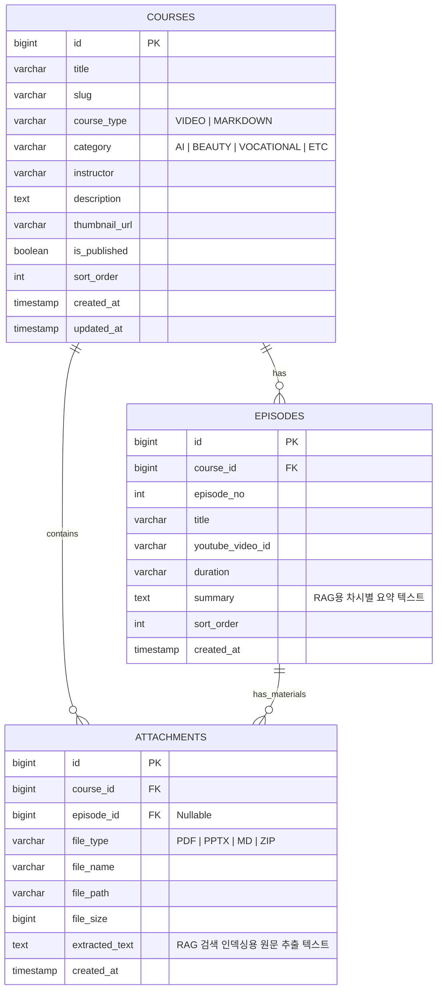
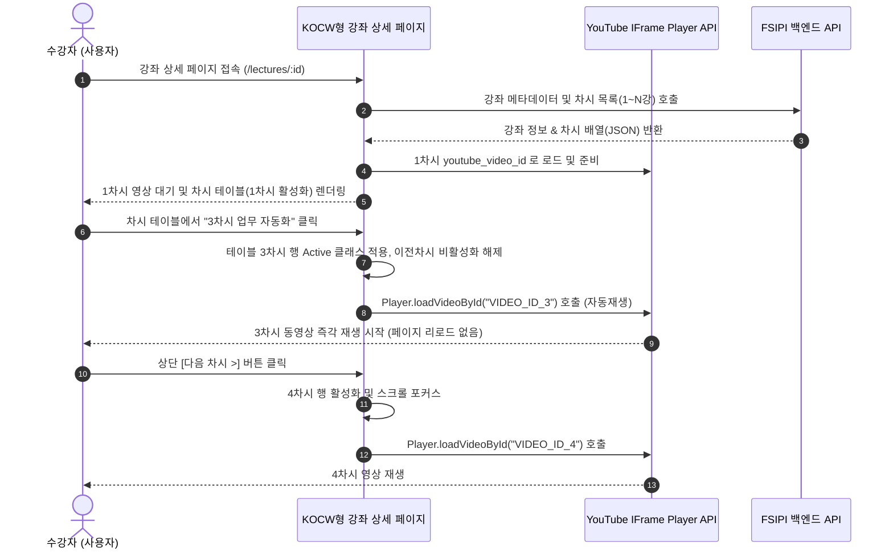

# [작업 지시서] 미래스마트산업진흥원(FSIPI) 온라인 강좌 아카이브 및 KOCW형 차시별 유튜브 강의 시스템 구축

---

- **문서 번호:** FSIPI-WO-20261030-02
- **프로젝트명:** 미래스마트산업진흥원(FSIPI) 공식 홈페이지 강좌 시스템 구축 및 관리자 고도화
- **기준 회의:** 2026년 10월 29일 돈화문로11다길 기획 회의 녹음 (`돈화문로11다길.m4a`)
- **참조 모델:** KOCW(코리아오픈코스웨어) 강의상세 화면 (`http://kocw.net/home/m/search/kemView.do?kemId=1558285`, '생성형 AI의 이해와 활용')
- **발주 기관:** 미래스마트산업진흥원 (FSIPI)
- **수신 대상:** 웹 개발사 PM, 프론트엔드/퍼블리셔, 백엔드 개발자
- **발행 일자:** 2026년 10월 30일
- **적용 범위:** GNB 메뉴 개편, 온라인 강좌 목록/상세(KOCW형 UI), 노션 마크다운(MD)/교재 뷰어, 관리자(차시 등록/MD 업로드) 및 RAG/MCP 확장 구조 구축

---

## 1. 개요 및 기획 배경

본 작업 지시서는 2026년 10월 29일 진행된 핵심 실무 회의(돈화문로11다길 녹음 분석)에서 확정된 요구사항을 바탕으로 작성되었습니다. 미래스마트산업진흥원(FSIPI)이 단순 기관 소개용 '정적 카탈로그 웹사이트'에 머무르지 않고, **실제 교육·연구 활동이 역동적으로 운영되고 있음을 대외적으로 증명**하기 위해 **온라인 강좌 및 강의 자료 아카이브 시스템**을 신규 구축합니다.

### 1.1 핵심 방향성 (회의 결정 사항)
1. **자체 스트리밍 인프라 구축 배제 (비용 최적화):**
   - 고비용의 미디어 스트리밍 서버 대신, **유튜브(전체공개 또는 일부공개/미등록 링크)**를 비디오 소스로 활용하여 호스팅 및 트래픽 비용을 0원으로 수렴시킵니다.
2. **KOCW형 차시별 강의 재생 UI 벤치마킹:**
   - KOCW 강의상세(`kemId=1558285`)의 검증된 사용자 경험을 도입합니다.
   - 상단에 **반응형 16:9 비디오 플레이어**를 배치하고, 하단에 **차시별 강의 목록(1강~20강 등)**을 노출하여, 차시 클릭 시 페이지 이동 없이 상단 플레이어 영상이 즉시 전환되는 구조를 구현합니다.
3. **노션(Notion) 마크다운(MD) 및 교재 업로드 지원:**
   - 강사가 노션에서 작성한 강의 노트를 마크다운(`.md`) 파일로 내보내어 관리자에 등록하면, GitHub/Velog 스타일로 정형화되어 웹에 자동 렌더링되는 텍스트 강의 기능을 제공합니다.
   - 캔바(Canva), 파워포인트(PPT), PDF로 제작된 강의 교재를 손쉽게 첨부 및 인라인 뷰어로 열람할 수 있도록 지원합니다.
4. **MVP 운영 원칙 준수 (자유게시판/일반회원 배제):**
   - 외부 사용자용 익명 자유게시판 및 일반 회원가입 기능은 관리 리소스 낭비와 스팸 우려로 전면 배제합니다.
   - 모든 대외 문의는 기존 '문의하기(`/contact`)' 창구로 일원화합니다.
5. **다분야 강사진(IT, 미용 등) 자료 공유 및 향후 RAG/MCP 확장성:**
   - 진흥원 내부 강사진(약 5명)의 강의를 포괄할 수 있는 유연한 카테고리 체계를 마련합니다.
   - 등록된 강의 텍스트/자료는 향후 **RAG(검색 증강 생성) 기반 AI 교육상담 챗봇 및 MCP(Model Context Protocol) 연동**에 재활용될 수 있도록 데이터 구조를 규격화합니다.

---

## 2. 정보구조(IA) 및 GNB 네비게이션 개편

기존 4대 GNB 체계에 신규 메뉴 **`온라인 강좌` (영문: `Lectures`)**를 정식 추가하여 총 5대 메뉴로 개편합니다.

### 2.1 상위 네비게이션 (GNB)
- `진흥원 소개` | `주요사업` | `온라인 강좌 (신설)` | `소식·성과` | `문의하기`

### 2.2 페이지 및 라우팅 매핑표

| 페이지 ID | URL | 페이지명 | 주요 구성 및 기능 | 비고 |
| :--- | :--- | :--- | :--- | :--- |
| **P-09** | `/lectures` | **강좌 목록** | 카테고리 탭(전체/IT·AI/융합미용/산업직무), 검색창, 강좌 카드 그리드, 페이징 | 신설 |
| **P-10** | `/lectures/:id` | **KOCW형 동영상 강좌 상세** | **[KOCW형 UI]** 상단 16:9 유튜브 플레이어, 이전/다음 차시 버튼, 하단 차시 목록(1강~N강), 교재 다운로드 | 신설 |
| **P-11** | `/lectures/note/:id` | **노션 MD 텍스트 강좌 상세** | 마크다운 파싱 렌더러(GitHub 스타일 스타일링), 목차(TOC), 첨부 교재(PDF/PPT) 다운로더 | 신설 |
| **ADM-03** | `/admin/lectures` | **강좌 관리 목록** | 강좌 목록 조회, 노출 상태(공개/비공개) 토글, 정렬 순서 조정, 신규 강좌 등록 버튼 | 관리자 |
| **ADM-04** | `/admin/lectures/write` | **강좌 등록/수정** | 기본정보(제목, 강사, 분야, 썸네일) + 차시별 유튜브 URL/제목 동적 행 추가 + MD/PDF 업로드 | 관리자 |

---

## 3. 화면별 상세 UI/UX 요구사항

### 3.1 [P-09] 온라인 강좌 목록 (`/lectures`)

1. **상단 필터 및 검색 바:**
   - **카테고리 탭:** `전체` | `인공지능·IT` | `스마트뷰티·미용` | `직업교육·자격` | `기타`
   - **강좌 형태 필터:** `전체` | `동영상 강좌(KOCW형)` | `텍스트/노트 강좌(MD)`
   - **검색창:** 강좌명, 강사명, 키워드 검색 (실시간 또는 검색 버튼 트리거)
2. **강좌 카드 그리드 (PC 3열 / 태블릿 2열 / 모바일 1열):**
   - **카드 구성 요소:**
     - 썸네일 이미지 (16:9 비율 유지, 미등록 시 기본 플레이스홀더 이미지 적용)
     - 유형 배지: `[동영상 N차시]` (파란색) 또는 `[강의노트/MD]` (초록색)
     - 강좌명 (최대 2줄 말줄임 `...` 처리)
     - 담당 강사명 (예: "김범준 원장 외")
     - 차시 정보 / 등록일
   - 카드 호버 시 부드러운 확대(Scale 1.02) 및 그림자 효과
3. **빈 화면 상태 (Empty State):**
   - 해당 조건의 강좌가 없을 경우: *"등록된 강좌가 없습니다."* 메시지 및 초기화 버튼 표출

---

### 3.2 [P-10] KOCW형 차시별 동영상 강좌 상세 (`/lectures/:id`)
> **벤치마킹 기준:** KOCW `kemId=1558285` (생성형 AI의 이해와 활용) 구조 적용

```
┌─────────────────────────────────────────────────────────────┐
│ [GNB 영역] 로고 | 진흥원소개 | 주요사업 | 온라인강좌 | 소식·성과 | 문의하기 │
├─────────────────────────────────────────────────────────────┤
│ < 강좌 목록으로 돌아가기                                           │
│ [강좌 기본 정보]                                              │
│ 카테고리 배지: [인공지능·IT] | [동영상 15차시]                      │
│ 강좌명: 생성형 AI의 실무 이해와 프롬프트 엔지니어링                  │
│ 강사진: 김범준 원장 | 교육기간: 2026년 2학기                        │
├─────────────────────────────────────────────────────────────┤
│ ┌─────────────────────────────────────────────────────────┐ │
│ │                                                         │ │
│ │             [ 16:9 반응형 유튜브 플레이어 영역 ]            │ │
│ │             (선택된 차시 영상이 임베드되어 재생됨)              │ │
│ │                                                         │ │
│ └─────────────────────────────────────────────────────────┘ │
│  현재 재생: 제 01-1차시. 강의 오리엔테이션 및 AI 기초 개요       │
│  [ < 이전 차시 ]                      [ 다음 차시 > ]       │
├─────────────────────────────────────────────────────────────┤
│ [탭 메뉴]  [차시별 강의 목록]  |  [강의 계획 및 소개]  |  [강의 자료]    │
├─────────────────────────────────────────────────────────────┤
│ [차시별 강의 목록 테이블 (KOCW형)]                           │
│ ┌───┬────────────────────────────────┬──────┬─────────────┐ │
│ │차시│ 강 의 명                        │시간  │ 강의자료    │ │
│ ├───┼────────────────────────────────┼──────┼─────────────┤ │
│ │ 1 │ [재생중] 01-1차시 강의소개      │25분  │ [교재 PDF]  │ │
│ │ 2 │ 01-2차시 프롬프트 기본 원리     │32분  │ [실습 MD]   │ │
│ │ 3 │ 02-1차시 업무 자동화 실습       │40분  │ [예제 ZIP]  │ │
│ │...│ ...                            │...   │ ...         │ │
│ └───┴────────────────────────────────┴──────┴─────────────┘ │
└─────────────────────────────────────────────────────────────┘
```

1. **상단 16:9 반응형 유튜브 플레이어:**
   - YouTube IFrame Player API 연동.
   - 플레이어 크기: `aspect-ratio: 16 / 9;`, `max-width: 1000px;` 중앙 정렬.
   - 파라미터: `rel=0`(추천 영상 최소화), `modestbranding=1`, `enablejsapi=1`.
   - 자동 재생 정책: 차시 클릭 변경 시 자동 재생(`autoplay=1`), 최초 진입 시에는 사용자 조작 대기.
2. **차시 내비게이션 바 (플레이어 직하단):**
   - 현재 재생 중인 차시 제목 표시 (예: *"제 1강. 생성형 AI 개요"*).
   - `[ < 이전 차시 ]`, `[ 다음 차시 > ]` 버튼:
     - 1차시일 경우 [이전 차시] 비활성화(Disabled).
     - 마지막 차시일 경우 [다음 차시] 비활성화(Disabled).
     - 클릭 시 하단 목록의 활성화 상태와 동기화되며 상단 플레이어 즉시 전환.
3. **차시별 강의 목록 테이블 (KOCW 리스트 구조):**
   - 컬럼 구성:
     - **차시(No):** 1, 2, 3 ...
     - **강의 제목:** 클릭 가능한 텍스트 링크. (현재 재생 중인 행에는 `active/highlight` 스타일 및 `[재생중]` 아이콘 부여)
     - **강의 시간(러닝타임):** 예: 25분 (선택 입력)
     - **강의 자료:** 등록된 첨부파일이 있을 경우 아이콘 버튼 (`PDF`, `MD`, `PPT`) 제공. 클릭 시 새 탭 열람 또는 즉시 다운로드.
4. **동적 전환 인터랙션 (SPA 동작):**
   - 차시 행 클릭 시 **페이지 새로고침(Reload) 없이 JavaScript로 상단 iframe의 src/videoId만 교체**하여 즉각적인 반응성 확보.
   - 모바일 환경에서는 차시 선택 시 상단 플레이어로 부드럽게 스크롤(Smooth Scroll) 이동.

---

### 3.3 [P-11] 노션 마크다운(MD) 텍스트 강좌 상세 (`/lectures/note/:id`)

1. **마크다운 렌더링 엔진 (Markdown-to-HTML):**
   - 관리자에서 업로드한 노션 내보내기 `.md` 파일을 웹에서 미려하게 렌더링.
   - GitHub Markdown CSS 또는 자체 커스텀 폰트/스타일 가이드 적용 (제목 H1~H4, 목록, 인용구, 수평선).
   - **코드 블록(Code Block):** 구문 강조(Syntax Highlighting, Prism.js 또는 highlight.js) 및 1클릭 복사 버튼.
   - **테이블(Table):** 반응형 가로 스크롤 지원.
   - **이미지:** 노션에서 내보낸 상대경로 이미지 또는 인라인 이미지의 반응형 최대 너비(100%) 처리 및 라이트박스 확대 지원.
2. **사이드 목차(TOC, Table of Contents):**
   - 본문 내 H2, H3 태그를 자동 감지하여 우측(데스크톱)에 Sticky TOC 생성.
   - 스크롤 위치에 따른 목차 활성화(Scrollspy) 및 클릭 시 해당 위치로 앵커 이동.
3. **강의 교재 첨부파일 박스:**
   - 본문 상단 또는 하단에 노션/캔바 원본 파일(PDF, PPT, ZIP) 다운로드 배너 배치.

---

## 4. 관리자(Admin) 기능 상세 요구사항

일반 사용자에게 노출되지 않는 비공개 관리자(`ADM-03`, `ADM-04`) 화면입니다.

### 4.1 강좌 등록/수정 화면 (`/admin/lectures/write`)

1. **강좌 기본 정보 입력부:**
   - **강좌 유형 선택 (Radio):** `[ 동영상 강좌 (유튜브/KOCW형) ]` vs `[ 텍스트 강좌 (노션 MD형) ]`
   - **강좌 제목:** 필수 입력 (Text)
   - **담당 강사진:** Text (기본값: "김범준 원장", 5인 강사진 중 선택 또는 텍스트 입력)
   - **카테고리:** Select (`인공지능·IT`, `스마트뷰티·미용`, `직업교육·자격`, `기타`)
   - **강좌 개요/소개:** Textarea (간략 소개글)
   - **대표 썸네일:** 파일 업로드 (JPG, PNG, WebP) 또는 YouTube 첫 번째 영상의 기본 썸네일 자동 추출 체크박스 (`https://img.youtube.com/vi/{VIDEO_ID}/hqdefault.jpg`)
   - **공개 여부:** Toggle (`공개` / `비공개` / `임시저장`)

2. **동영상 강좌 차시 등록기 (동영상 유형 선택 시 노출):**
   - **동적 행 추가/삭제 기능:** `[ + 차시 추가 ]` 버튼 클릭 시 새로운 행 생성.
   - **행별 입력 필드:**
     - 차시 번호 (자동 1, 2, 3...)
     - 차시 제목 (예: "01강. 생성형 AI 개요")
     - **유튜브 URL 또는 Video ID:** (예: `https://www.youtube.com/watch?v=xxxx`, `https://youtu.be/xxxx`, `xxxx` 모두 정규식으로 Video ID 자동 추출)
     - 강의 시간 (선택, 예: "25:30")
     - 차시별 교재 첨부 (PDF/PPT/MD 파일 업로드, 최대 50MB)
   - **드래그 앤 드롭 순서 변경:** 차시 행을 위아래로 끌어서 순서를 변경할 수 있는 핸들러 제공.

3. **노션 마크다운(MD) 업로더 (텍스트 강좌 유형 선택 시 노출):**
   - **MD 파일 단일 업로드:** 드래그 앤 드롭 영역에 `.md` 파일 업로드 시 즉시 본문 텍스트에 로드 및 실시간 미리보기(Live Preview) 지원.
   - **이미지 일괄 업로드 (선택):** 노션에서 이미지와 함께 압축된 `.zip` 파일을 올리면 서버에서 압축을 해제하여 본문 이미지 링크를 자동 매핑하거나, 본문 에디터에 이미지 직접 첨부 지원.
   - **첨부 교재 업로드:** PDF, PPTX 파일 다중 첨부 지원.

---

## 5. 데이터베이스(DB) 모델 및 API 설계 가이드

향후 **RAG(검색 증강 생성) 기반 AI 질의응답 및 MCP 도구 연동**을 원활히 지원할 수 있도록 정규화된 스키마를 구성합니다.

### 5.1 데이터베이스 ERD 구조



### 5.2 RAG / MCP 확장성 고려 사항 (기술 명세)
- `EPISODES.summary` 및 `ATTACHMENTS.extracted_text`:
  - 향후 진흥원 AI 에이전트(MCP Server)가 강좌 내용을 검색(`search_lectures`)하거나 사용자 질의에 답변할 때 사용할 텍스트 필드입니다.
  - 마크다운 업로드 시 본문 텍스트는 자동으로 플레인 텍스트로 파싱되어 DB에 캐싱 저장되어야 합니다.

---

## 6. 프론트엔드 컴포넌트 아키텍처 및 인터랙션 흐름



---

## 7. 비기능적 요구사항 (NFR)

1. **반응형 웹 지원 (Responsive Design):**
   - 모바일(375px~), 태블릿(768px~), 데스크톱(1440px~) 완벽 대응.
   - 모바일 환경에서 유튜브 플레이어가 화면 가로폭에 맞게 100% 핏(Fit)되며 좌우 스크롤 깨짐이 발생하지 않을 것.
2. **유튜브 임베드 최적화 (성능 및 개인정보):**
   - 도메인: `www.youtube-nocookie.com` 적용 (쿠키/개인정보 보호 강화 및 로딩 성능 개선).
   - 초기 페이지 로드 시 모든 유튜브 iframe을 무겁게 생성하지 않고, 메인 플레이어 1개만 IFrame API로 동적 제어.
3. **보안 및 XSS 방어 (노션 MD 렌더링):**
   - 마크다운을 HTML로 파싱할 때 `DOMPurify` 등을 반드시 거쳐 악성 스크립트(`<script>`, `onerror`, 인라인 자바스크립트 등)를 무조건 살균(Sanitize) 처리.
4. **접근성 (A11y):**
   - 차시 목록의 버튼 및 링크에 명확한 `aria-label` 및 `role="button"` 제공.
   - 키보드 Tab 키로 차시 목록 탐색 및 엔터키 재생 지원.

---

## 8. 인수검수 체크리스트 (Acceptance Criteria, AC-01 ~ AC-15)

본 온라인 강좌 시스템은 다음 15개 기준을 모두 충족해야 최종 검수가 승인됩니다.

- [ ] **AC-01 (GNB 연동):** 상단 네비게이션에 `온라인 강좌` 메뉴가 정상 노출되며 `/lectures`로 올바르게 이동하는가?
- [ ] **AC-02 (강좌 목록 렌더링):** 카테고리 탭(IT·AI, 미용, 직업 등)과 동영상/노트 유형별 필터링이 즉각 동작하는가?
- [ ] **AC-03 (KOCW 레이아웃 일치):** 동영상 강좌 상세 화면이 상단 16:9 플레이어 + 하단 차시 목록 테이블 구조를 정확히 갖추었는가?
- [ ] **AC-04 (차시 클릭 전환):** 차시 목록에서 특정 강의 클릭 시, **새로고침 없이 상단 플레이어의 영상이 즉시 해당 유튜브 영상으로 교체/재생**되는가?
- [ ] **AC-05 (이전/다음 차시 버튼):** 플레이어 하단 `[이전 차시]`, `[다음 차시]` 버튼이 정상 작동하며, 처음과 끝 차시에서 비활성화(Disabled) 처리가 되는가?
- [ ] **AC-06 (차시 활성 상태 표시):** 현재 재생 중인 차시 행에 시각적 하이라이트(색상, 배지, 볼드체)가 명확히 표시되는가?
- [ ] **AC-07 (유튜브 URL 정규화):** 관리자 화면에서 풀 URL(`watch?v=`), 축약 URL(`youtu.be/`), 단순 Video ID 중 어느 것을 넣어도 시스템이 올바르게 ID를 추출하여 저장하는가?
- [ ] **AC-08 (차시 순서 드래그 앤 드롭):** 관리자에서 차시 행의 순서를 마우스 드래그로 손쉽게 재배치하고 저장할 수 있는가?
- [ ] **AC-09 (노션 MD 파일 렌더링):** 노션에서 내보낸 `.md` 파일을 업로드했을 때, 코드블록, 표, 인용구, 제목 스타일이 깨짐 없이 미려하게 웹에 렌더링되는가?
- [ ] **AC-10 (XSS 보안 검증):** 마크다운 렌더링 시 외부 악성 스크립트 태그가 완전히 무력화(Sanitizing)되는가?
- [ ] **AC-11 (교재 다운로드):** 차시별 또는 강좌별로 등록된 첨부파일(PDF, PPT, ZIP)이 손상 없이 정상 다운로드/열람되는가?
- [ ] **AC-12 (일반 회원가입/자유게시판 배제):** 음성 회의 결정에 따라 외부 사용자용 자유게시판이나 불필요한 회원가입 창구가 일체 노출되지 않는가?
- [ ] **AC-13 (모바일 반응형 최적화):** 스마트폰(375px) 화면에서 플레이어가 찌그러지지 않고, 차시 목록 테이블이 가독성 높은 모바일 리스트 형태로 자연스럽게 변환되는가?
- [ ] **AC-14 (비공개 강좌 차단):** 관리자에서 비공개로 설정된 강좌는 일반 목록에서 숨겨지며, 직접 URL 접근 시 404 안내 페이지로 유도되는가?
- [ ] **AC-15 (향후 확장 데이터 보존):** DB에 차시별 요약 및 텍스트 데이터가 규격화된 형태로 저장되어 향후 RAG/MCP 연동이 가능한 구조인가?

---

## 9. 최종 산출물 및 제출 목록

개발사는 본 작업 완료 시 발주자(FSIPI)에게 아래 산출물을 제출해야 합니다.

1. **온라인 강좌 시스템 기능 명세서 및 UI 캡처본 (PC / Mobile)**
2. **KOCW형 차시 전환 및 유튜브 API 연동 테스트 보고서**
3. **노션 MD 파서 및 XSS 살균 테스트 결과 보고서**
4. **관리자용 강좌 등록 매뉴얼 (유튜브 차시 등록, MD 업로드 가이드)**
5. **수정된 소스코드 (Git 리포지토리 최신 커밋 푸시 및 배포 완료)**
6. **인수검수 체크리스트(AC-01~AC-15) 서명 완료본**

---

> **[운영 및 정책 가이드]**  
> 1. 모든 영상 콘텐츠는 진흥원 공식 유튜브 채널(또는 원장 공식 채널)에 먼저 업로드한 후, 해당 링크를 통해 등록하는 것을 원칙으로 합니다.  
> 2. 노션에서 작성한 강의 자료는 마크다운(.md) 내보내기 시 기본 서식(H1~H3, 코드, 불릿)을 준수할 때 가장 최적의 렌더링 품질을 보장합니다.  
> 3. 본 작업 지시서의 기준은 2026.10.29 돈화문로11다길 회의 및 KOCW 표준 UI를 최우선으로 적용합니다.