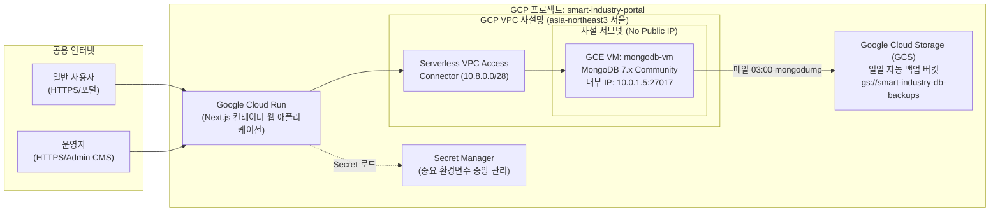

# 서버 및 인프라 계정 인계서 템플릿 (06)

- **문서 번호**: FSIPI-DELIV-20261026-06
- **프로젝트명**: 미래스마트산업진흥원 홈페이지 통합 구축 (MVP v3.0)
- **작성일자**: 2026년 10월 26일
- **작성자**: 클라우드 인프라 엔지니어 (Cloud Infra & DevOps Engineer)
- **보안 등급**: 대외비 (Confidential - 진흥원 내부 인계용)

---

## 1. 인프라 아키텍처 개요 (GCP 기반 자체 운영)

본 시스템은 외부 SaaS DB(Atlas 등)를 배제하고, **Google Cloud Platform(GCP) Compute Engine(GCE) 가상머신에 MongoDB를 직접 구축**하여 완벽한 사설망 격리(VPC)를 달성한 아키텍처입니다.



---

## 2. GCE MongoDB 자체 운영 인프라 상세

### 2-1. GCE 가상머신 사양
- **인스턴스명**: `fsi-mongo-prod-vm`
- **리전 / 존**: `asia-northeast3-a` (서울 리전)
- **머신 유형**: `e2-standard-2` (2 vCPU, 8GB Memory)
- **운영체제**: Ubuntu 22.04 LTS
- **보안 격리 정책**:
  - **공인 IP(External IP)**: **미할당(None)** -> 인터넷에서 직접 접근 불가능.
  - **사설 IP(Internal IP)**: `10.0.1.5`
  - **방화벽 규칙**: 포트 `27017`은 VPC 내부 서브넷 및 VPC 커넥터 대역(`10.8.0.0/28`)에서만 인바운드 허용, 외부 인터넷 0.0.0.0/0 완전 차단.
- **인증 모드**: SCRAM-SHA-256 강제 (`security.authorization: enabled`).

### 2-2. Serverless VPC Access 커넥터
- **커넥터명**: `fsi-vpc-connector`
- **VPC 네트워크**: `fsi-vpc`
- **IP 대역**: `10.8.0.0/28`
- **역할**: Cloud Run 컨테이너가 공인 인터넷을 거치지 않고 사설망 내 GCE VM(10.0.1.5:27017)과 다이렉트로 안전하게 통신.

---

## 3. 일일 자동 백업 및 복구(Restore) 리허설 절차

### 3-1. 일일 백업 크론탭 스크립트 (`/opt/scripts/backup-mongo.sh`)
- **실행 주기**: 매일 새벽 03:00 (KST)
- **백업 방식**: `mongodump --gzip` 압축 덤프 -> Google Cloud Storage(`gs://smart-industry-db-backups/daily/`) 업로드.
- **보관 정책**: GCS Lifecycle 정책을 통해 30일 경과 백업본 자동 삭제.

```bash
#!/bin/bash
set -euo pipefail

TIMESTAMP=$(date +"%Y%m%d_%H%M%S")
BACKUP_DIR="/tmp/mongodump_${TIMESTAMP}"
BUCKET="gs://smart-industry-db-backups/daily"

# 1. 덤프 생성
mongodump --uri="${MONGODB_URI}" --gzip --archive="${BACKUP_DIR}.archive.gz"

# 2. GCS 업로드
gsutil cp "${BACKUP_DIR}.archive.gz" "${BUCKET}/${TIMESTAMP}.archive.gz"

# 3. 로컬 임시파일 삭제
rm -f "${BACKUP_DIR}.archive.gz"
echo "[BACKUP SUCCESS] Backup completed and uploaded: ${BUCKET}/${TIMESTAMP}.archive.gz"
```

### 3-2. 긴급 복구(Restore) 리허설 가이드
장애 발생 시 최신 GCS 덤프 파일을 다운로드하여 10분 이내에 복원할 수 있습니다.

```bash
# 1. 백업본 다운로드
gsutil cp gs://smart-industry-db-backups/daily/20261026_030000.archive.gz /tmp/restore.archive.gz

# 2. 몽고DB 복원 실행
mongorestore --uri="${MONGODB_URI}" --gzip --archive=/tmp/restore.archive.gz --drop

# 3. 완료 확인
mongosh "${MONGODB_URI}" --eval "db.posts.countDocuments()"
```

---

## 4. 인프라 계정 및 시크릿 인계서 템플릿

| 자산 구분 | 식별자 / 리소스명 | 기본 접속 계정 | 관리 방침 / 비고 |
| :--- | :--- | :--- | :--- |
| **GCP 프로젝트** | `smart-industry-portal` | 진흥원 공식 조직 계정 | GCP Console 소유자 권한 인계 |
| **Cloud Run 서비스** | `fsi-portal-service` | Service Account | Artifact Registry 배포 권한 |
| **GCE VM (MongoDB)** | `fsi-mongo-prod-vm` | `gcp-admin` (IAP 터널링) | SSH 직접 포트 오픈 금지, IAP 사용 |
| **MongoDB Root** | `admin` | SCRAM-SHA-256 | Secret Manager `MONGODB_ROOT_PASSWORD` 참조 |
| **MongoDB App User**| `fsi_app_user` | SCRAM-SHA-256 | `smart_industry` DB readWrite 권한 |
| **Secret Manager** | `fsi-prod-secrets` | 암호화 보관 | MONGODB_URI, SESSION_SECRET 등 관리 |
| **도메인 DNS** | `smartindustry.or.kr` | 기관 도메인 등록기관 | Cloud Run 도메인 매핑(A/AAAA/CNAME) |
| **SSL 인증서** | `Let's Encrypt / Google Managed` | 자동 갱신 | Cloud Run 매니지드 HTTPS 인증서 자동 갱신 |
