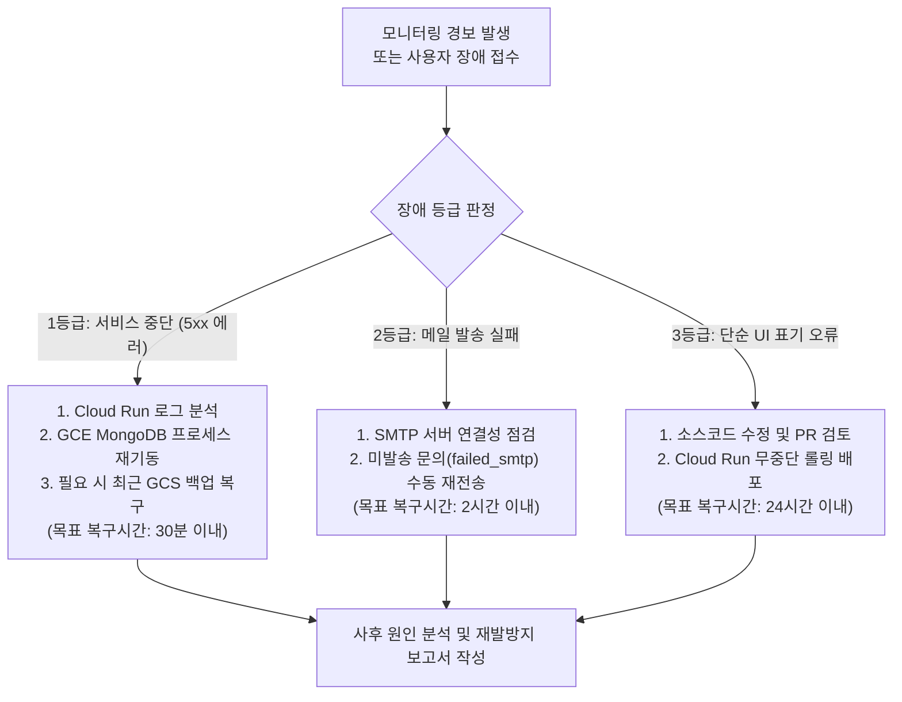

# 유지보수 및 기술지원 계획서 (08)

- **문서 번호**: FSIPI-DELIV-20261026-08
- **프로젝트명**: 미래스마트산업진흥원 홈페이지 통합 구축 (MVP v3.0)
- **작성일자**: 2026년 10월 26일
- **작성자**: 총괄 아키텍트 (Orchestrator), 클라우드 데브옵스 엔지니어

---

## 1. 개요 및 기술지원 목표

본 계획서는 미래스마트산업진흥원 홈페이지 통합 구축(MVP v3.0) 오픈 이후의 안정적인 운영, 무중단 서비스 제공, 데이터 무결성 보장, 그리고 보안 취약점 예방을 위한 사후 기술지원 및 유지보수 표준 절차를 정의합니다.

---

## 2. 상시 모니터링 및 상태 점검 체계

### 2-1. 클라우드 인프라 모니터링 (GCP Cloud Monitoring)
1. **Cloud Run 서비스 헬스 체크**:
   - 가용성(Uptime) 체크: 1분 간격으로 메인 화면(`/`) 및 고정 URL HTTP 상태 점검.
   - 레이턴시 임계치: 95th 백분위수 응답 시간 1.5초 초과 시 슬랙/이메일 알림.
   - 에러율 알림: HTTP 5xx 에러율 1% 초과 시 비상 알림 발송.
2. **GCE VM MongoDB 리소스 모니터링**:
   - CPU/메모리 사용률: 80% 초과 지속 시 경보.
   - 디스크 용량: 데이터베이스 볼륨 잔여 용량 25% 미만 시 스토리지 자동 확장 검토.
   - 포트 연결성: 27017 VPC 내부 연결 상태 주기적 헬스체크.

### 2-2. 정기 점검 주기표

| 점검 항목 | 점검 주기 | 담당자 | 점검 내용 및 조치 기준 |
| :--- | :---: | :---: | :--- |
| **GCS 일일 백업 확인** | **주 1회 (매주 월)** | 시스템 관리자 | `gs://smart-industry-db-backups/daily/` 최신 덤프 생성 여부 및 파일 크기 점검 |
| **보안 감사로그 검토** | **월 1회** | 보안 관리자 | 비정상적인 관리자 로그인 시도(IP 차단 이력, 실패 5회 계정 잠금) 감사 |
| **SSL 인증서 유효기간**| **월 1회** | 인프라 엔지니어| 매니지드 HTTPS 인증서 자동 갱신 상태 점검 (만료 30일 전 확인) |
| **의존성 보안 패치** | **분기 1회** | 기술지원팀 | Next.js, Node.js 런타임 보안 권고(`npm audit`) 확인 및 패치 적용 |

---

## 3. 장애 유형별 대응 절차 (Incident Response)

---

## 4. 콘텐츠 관리 및 기술지원 범위

1. **운영자 기술지원**:
   - 관리자 CMS 사용법, 마크다운 작성, 메인 3선 노출 관리 지원.
   - 비영리단체 고유번호증 발급 후 푸터 공식 등록번호 반영 지원.
2. **문의 채널**:
   - 공식 기술지원 이메일: `support@smartindustry.or.kr`
   - 긴급 장애 연락망: 시스템 아키텍트 비상 핫라인.
