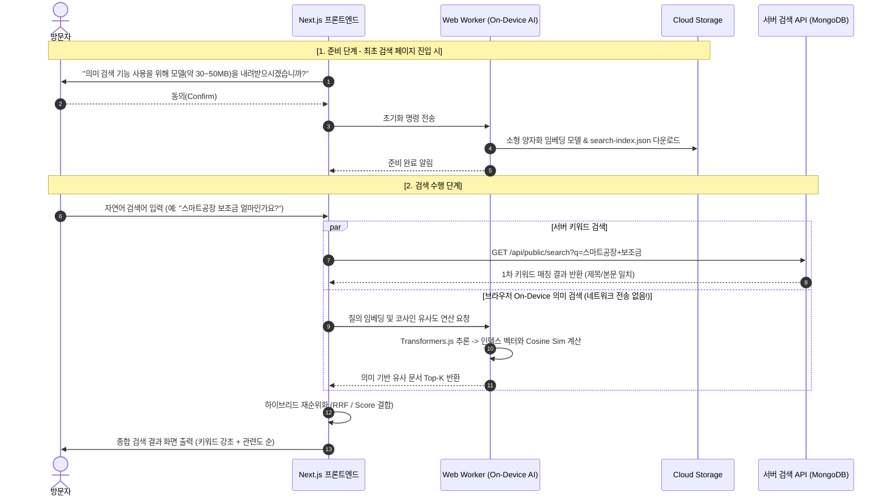
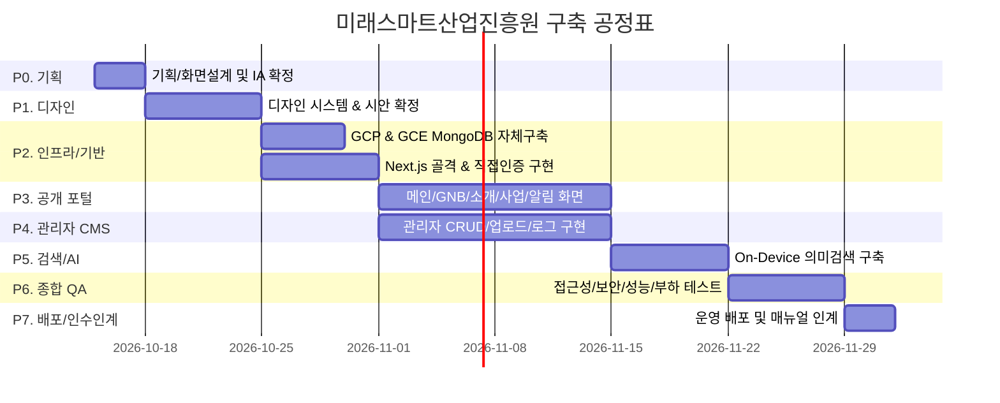

# 작업지시서 — 미래스마트산업진흥원 안내 사이트 구축

| 항목 | 내용 |
|---|---|
| 문서 버전 | **v1.2** (v1.1 대비 변경: §0 참조) |
| 작성일 | 2026-10-14 |
| 프로젝트명 | 미래스마트산업진흥원 안내 사이트 |
| 성격 | 기관 소개·사업·알림·자료를 안내하는 **정보 제공형 웹사이트** + 콘텐츠 관리용 **관리자 페이지** |
| 레퍼런스 | ① NIA 한국지능정보사회진흥원 `https://www.nia.or.kr/site/nia_kor/main.do`<br>② 한국인공지능·소프트웨어산업협회(KOSA) `https://www.sw.or.kr/site/sw/main.do` |
| 확정 기술 | **React (Next.js App Router) · MongoDB (GCP GCE 자체 운영) · Google Cloud** |
| AI 방침 | **On-Device 의미 검색만 적용.** 사용자 질의를 외부 서버로 전송하지 않음. AI 안내 도우미(챗봇/LLM)는 **제외** |

> [!NOTE]
> 제공된 정보에 **기관의 실제 콘텐츠(조직·사업·연락처·로고 등)가 없습니다.** 콘텐츠는 §10 확인 사항 회신 전까지 **더미(placeholder)** 로 구현합니다.

---

## 0. 변경 이력

| 버전 | 일자 | 주요 변경 내용 | 영향 항목 |
|---|---|---|---|
| v1.0 | 2026-10-14 | 초안 작성 (Astro SSG + Markdown 정적 구조, AI 도우미 포함) | 초기 설계 |
| v1.1 | 2026-10-14 | 사용자 피드백 반영: ① AI 안내 도우미 제외 ② Google Cloud 호스팅 ③ 사업 신청 기능 제외 ④ React + MongoDB 도입으로 관리자 페이지 신설 | 전체 아키텍처 및 WBS |
| **v1.2** | 2026-10-14 | **사용자 2차 피드백 확정 반영**:<br>① **Next.js (App Router) 확정** (SSR/ISR 하이브리드 최적화)<br>② **MongoDB 자체 운영 확정** (Atlas 대신 GCP Compute Engine VM에 MongoDB 직접 설치·운영, VPC 격리, GCS 백업 파이프라인 신설)<br>③ **관리자 로그인 직접 입력 방식 확정** (Google OAuth 대신 아이디/비밀번호 + Argon2id/bcrypt 해싱, 5회 실패 계정 잠금, 레이트리밋 적용) | §4.6, §5, §7.4, §8, §9, §10 |

---

## 1. 목표와 범위

### 1.1 목표
1. 방문자(기업·예비창업자·일반 국민·언론)가 원하는 사업/공지/자료를 **3클릭 이내**에 찾는다.
2. 공공·진흥기관 홈페이지의 신뢰감 있는 정보구조(IA)를 따르되, 레거시 구조(jQuery, 세션ID URL, 과도한 팝업)는 현대 스택으로 대체한다.
3. 운영자가 **개발자 없이 관리자 페이지**로 콘텐츠를 등록·수정·게시한다.
4. 검색은 키워드 + **On-Device 의미 검색**으로 품질을 높이되, 사용자 입력은 기기 밖으로 나가지 않는다.
5. GCP 인프라 상에서 **Next.js 컨테이너(Cloud Run)** 와 **자체 운영 MongoDB(Compute Engine)** 간의 안전한 내부 VPC 통신 및 자동 백업 체계를 갖춘다.

### 1.2 범위 (In Scope)
- 반응형 웹사이트 (PC / 태블릿 / 모바일)
- 메인, 기관소개, 사업안내, 알림마당, 자료실, 이용안내, 정책 페이지
- 통합검색 (키워드 + On-Device 의미 검색)
- **관리자 페이지**: 직접 아이디/비밀번호 로그인, 콘텐츠 CRUD, 첨부 업로드, 배너/퀵링크 관리, 임시저장·게시·예약게시, 감사로그
- Next.js (App Router) 풀스택 아키텍처 (React Server Components, Server Actions/Route Handlers)
- **자체 운영 MongoDB 구축**: GCP Compute Engine VM, Persistent Disk, 내부망 통신, 일일 자동 백업 스크립트(GCS 저장)
- Google Cloud 기반 배포·운영(Serverless VPC Access, Cloud Run, Cloud Storage, CI/CD, 모니터링)
- 웹 접근성, SEO, 성능, 보안 기준 충족

### 1.3 범위 제외 (Out of Scope)
- **AI 안내 도우미(챗봇/RAG/LLM 생성)**
- **사업 신청·접수·결제 등 신청 관련 기능** (정보 안내 전용)
- 일반 방문자 회원가입/로그인, 방문자 글쓰기(댓글·Q&A 게시판)
- 클라우드 LLM 유료 API 호출
- 다국어(영문) 사이트 — 1차 제외 (구조만 다국어 확장 가능 설계)
- 레퍼런스 사이트의 이미지·로고·문구 **복제** (구조·UX만 참고)

---

## 2. 레퍼런스 분석 결과

### 2.1 사이트별 구조 요약

| 구분 | NIA (nia.or.kr) | KOSA (sw.or.kr) |
|---|---|---|
| 상단 | 공지 배너 슬라이더(1일간 열지 않음), SNS·영문 링크, 전체메뉴 버튼 | 유틸바(카카오채널·뉴스레터·로그인·회원가입·ENGLISH), GNB 8개, 검색, **인공지능기본법 지원데스크** 상시 버튼 |
| GNB | 인공지능 / 주요사업 / 지식정보 / 알림마당 / 윤리경영 등 | AI 선도기관 / 사업지원 / 인재지원 / 해외진출지원 / 알림마당 / 회원공간 / 협회안내 / 인재채용 |
| 메인 구성 | ① 주요사업 아이콘 캐러셀(9개 본부) ② **지식정보**(발간물 5건) ③ **알림마당**(입찰·공지 5건) ④ 푸터 | ① 협회활동 이미지 슬라이더 ② **신청·발급 퀵링크 6종** ③ **새소식 탭**(전체/공지/보도자료) ④ **교육 프로그램** 슬라이더(접수중 뱃지) ⑤ 회원공간 3카드 ⑥ 주요활동 슬라이더 |
| 정보 유형 | 간행물, 연구보고서, 통계·실태조사, 법령·규정, 입찰공고, 보도자료, 뉴스레터, 채용 | 수·발주지원, 시장활성화, 법령정보, 교육신청, 행사·전시, 회원서비스 |
| 푸터 | 대표전화, 개인정보처리방침, 저작권 정책, 찾아오시는 길, 업무담당자 조회, **패밀리사이트 셀렉트**, 주소(본원/사무소) | 협회 정보, 정책 링크 |
| 접근성 | 본문/메뉴 건너뛰기, title·aria 보강, 슬라이드 재생/정지 버튼 | 바로가기 메뉴(본문/주메뉴) |

### 2.2 채택할 패턴 (Adopt)
1. 카테고리 기반 GNB + **전체메뉴(메가메뉴)**
2. 메인 **퀵링크(자주 찾는 서비스) 그리드** — 신청·발급 제외, "정보 바로가기"로 재구성
3. **새소식 탭(전체/공지/보도자료/행사)**
4. 공지 배너 슬라이더 + 재생/정지 + "오늘 하루 열지 않음"
5. **상태 뱃지(접수중/예정/마감)** — 사업·행사·공모 정보 안내용
6. 푸터 패밀리사이트 + 개인정보처리방침·저작권·오시는 길
7. 본문 바로가기(Skip navigation) 및 슬라이드 제어 접근성

### 2.3 개선할 점 (Improve)
| 레퍼런스의 한계 | 본 프로젝트 개선 |
|---|---|
| 메인에 팝업·배너·캐러셀 과다 | 메인 핵심 영역 **6개 이하**, 자동재생 슬라이드 최대 1개 |
| URL에 `jsessionid` 노출, `javascript:` 링크로 게시글 이동 | **시맨틱 정적 URL**(`/news/notice/2026-10-sample`) + 표준 `<a href>` |
| jQuery 1.x + 플러그인 다수 | React Server Components 기반 최소 클라이언트 JS 번들 |
| 통합검색이 키워드 일치 위주 | **On-Device 의미 검색**(오타·동의어·자연어 보정) |
| 메뉴가 깊어 원하는 사업 찾기 어려움 | 사업 목록의 **대상·분야·상태 필터** |

---

## 3. 정보구조(IA) / 사이트맵

```
/ (메인)
├─ 진흥원 소개           /about
│   ├─ 인사말·비전        /about/vision
│   ├─ 연혁              /about/history
│   ├─ 조직·담당자 안내   /about/organization
│   └─ 찾아오시는 길      /about/location
├─ 사업안내              /programs
│   ├─ 사업 전체(목록·필터) /programs
│   └─ 사업 상세          /programs/[slug]
├─ 알림마당              /news
│   ├─ 공지사항          /news/notice
│   ├─ 보도자료          /news/press
│   ├─ 행사·교육 일정    /news/events
│   └─ 입찰·공모         /news/bids
├─ 자료실                /resources
│   ├─ 간행물·보고서      /resources/publications
│   ├─ 통계·동향          /resources/statistics
│   └─ 법령·규정         /resources/regulations
├─ 이용안내              /guide
│   ├─ 자주 묻는 질문(FAQ) /guide/faq
│   ├─ 문의 안내(연락처·메일 링크) /guide/contact
│   └─ 사이트맵          /sitemap
├─ 정책                  /privacy, /copyright, /accessibility
├─ 검색                  /search
└─ 관리자(비공개)        /admin  (robots.txt 차단, noindex)
    ├─ 로그인            /admin/login
    ├─ 대시보드          /admin/dashboard
    ├─ 게시물 관리        /admin/posts
    ├─ 사업안내 관리      /admin/programs
    ├─ 자료실 관리        /admin/resources
    ├─ FAQ 관리          /admin/faqs
    ├─ 배너/퀵링크 관리   /admin/banners
    ├─ 페이지 콘텐츠 관리 /admin/pages
    ├─ 사이트 설정       /admin/settings
    ├─ 관리자 계정 관리   /admin/users
    └─ 감사로그          /admin/audit-logs
```

---

## 4. 화면별 요구사항

### 4.1 메인 페이지 (`/`)
| 순서 | 영역 | 설명 | 데이터 컬렉션 |
|---|---|---|---|
| 1 | 공지 배너 | 최대 3건, 재생/정지, "오늘 하루 열지 않음"(localStorage), 노출 기간 제어 | `banners` |
| 2 | 히어로 + 통합검색 | 기관 비전 한 줄 메시지, **중앙 검색창**, 추천/인기 검색어 | `siteSettings` |
| 3 | 빠른 메뉴(퀵링크) | 카드 6개 (사업안내, 행사·교육, 자료실, FAQ, 오시는 길, 문의 안내) | `quicklinks` |
| 4 | 주요 사업 | 카드 4~6개, 상태 뱃지 (신청 기능 없음, 상세 안내 이동) | `programs` |
| 5 | 새소식 탭 | 전체/공지/보도자료/행사 탭 전환, 각 5건, 더보기 링크 | `posts` |
| 6 | 자료실 하이라이트 | 최신 발간물/보고서 3건 카드 | `resources` |

### 4.2 목록 페이지 공통 (공지·보도·행사·입찰·자료·사업)
- 키워드 검색(제목/본문), 카테고리 필터, 정렬(최신순), 서버 사이드 페이지네이션(10건/페이지)
- URL 쿼리로 상태 보존 (`?q=&cat=&page=2`)
- 첨부파일 다운로드 아이콘 및 파일 형식/용량 표시

### 4.3 상세 페이지 공통
- 제목·등록일·분류·담당부서, 마크다운 기반 본문(HTML 살균 처리), 첨부파일 다운로드 목록, 이전글/다음글 네비게이션, 목록 버튼, URL 복사 기능
- 조회수는 정적 정보 사이트 특성상 **미표시**

### 4.4 사업 상세 (`/programs/[slug]`)
- 구성: 사업 개요 → 지원 대상 → 지원 내용 → 추진 일정 → 담당 부서/문의처 → 관련 공지사항
- 상단 **요약 카드**(대상·기간·상태·담당부서)
- (선택 항목) **공고 원문 / 관련 공식 사이트 링크**(외부 링크로 새창 열기, 등록된 경우에만 노출). **신청 접수/폼/버튼은 미배치**

### 4.5 통합검색 (`/search`)
- 기본: **키워드 검색** (MongoDB 텍스트 인덱스 + 정규화 검색)
- 향상: **On-Device 의미 검색** (브라우저 내 임베딩 유사도 계산)
- 결과 그룹핑: 사업 / 알림 / 자료 / FAQ / 일반 안내, 매칭 구절 하이라이트

### 4.6 관리자 페이지 (`/admin`)
| 메뉴 | 기능 |
|---|---|
| **직접 로그인** | **아이디(이메일 또는 사용자명) + 비밀번호 직접 입력 방식**<br>• 비밀번호 해싱: Argon2id 또는 bcrypt (12 rounds)<br>• 무차별 대입 방어: 연속 5회 실패 시 15분 계정 잠금 + IP 레이트리밋<br>• 보안 세션: HTTP-Only, Secure, SameSite=Strict 쿠키 기반 세션 (30분 무활동 자동 만료) |
| **대시보드** | 최근 수정 이력, 게시 대기/예약 건수, 만료 임박 배너 현황, 시스템 상태 요약 |
| **게시물 관리** | 공지/보도/행사/입찰 CRUD, 임시저장·즉시게시·예약게시·비공개, 상단 고정 |
| **사업 관리** | 사업 정보 CRUD, 진행 상태(접수중/예정/마감) 수동 설정 또는 기간 자동 판별 |
| **자료실 관리** | 간행물/통계/법령 CRUD, 첨부파일 관리(Cloud Storage 연동) |
| **FAQ 관리** | 질문/답변 등록, 카테고리 분류, 드래그 앤 드롭 표시 순서 조정 |
| **배너·퀵링크** | 이미지 등록, 노출 기간, 표시 순서, 대체텍스트(alt) 필수 입력 검증 |
| **페이지 편집** | 소개(인사말/연혁/조직/오시는길), 정책 3종 본문 마크다운 편집기 + 실시간 미리보기 |
| **사이트 설정** | 대표 전화/팩스, 주소, 푸터 패밀리사이트 링크, 추천 검색어 목록 관리 |
| **관리자 관리** | 관리자 계정 생성/수정/삭제, 비밀번호 강제 재설정, 권한(Admin/Editor) 관리 |
| **감사로그** | 관리자 로그인 이력, 모든 콘텐츠 등록/수정/삭제 로그(수정·삭제 불가 불변 로그) |

---

## 5. 기술 스택 및 아키텍처

### 5.1 기술 스택 정의
| 계층 | 기술 | 선정 및 상세 사유 |
|---|---|---|
| **프론트엔드/웹** | **React + Next.js (App Router) + TypeScript** | • **Next.js 확정**: 공공기관 포털의 필수 요건인 SEO, 초기 LCP 최적화(SSR/ISR), 보안 헤더 제어 용이<br>• Server Component 기반으로 클라이언트 JS 번들 크기 대폭 감축 |
| **스타일링** | **Tailwind CSS + CSS Variables (Design Tokens)** | 컴포넌트 일관성 유지, 유틸리티 클래스로 미사용 CSS 제거 최적화 |
| **백엔드/API** | **Next.js Route Handlers & Server Actions** | 단일 코드베이스 모노레포로 운영 복잡도 최소화, 타입 안정성(End-to-End Type Safety) 보장 |
| **데이터베이스** | **MongoDB (GCP Compute Engine 직접 운영)** | • **직접 운영 확정**: GCP 서울 리전 VM 내 MongoDB 직접 설치·운영<br>• 데이터 및 설정에 대한 완전한 통제권 확보, 비용 예측 가능성 확보<br>• Mongoose ODM 사용으로 스키마 검증 및 비즈니스 모델 캡슐화 |
| **인증/인가** | **직접 구현 자격증명 인증 (Credentials Auth)** | • **직접 입력 방식 확정**: 아이디/비밀번호 기반 로그인<br>• Argon2id 또는 bcrypt 해싱, JWT 또는 DB 세션 토큰을 `HttpOnly` 쿠키로 전달<br>• RBAC(Role-Based Access Control): `Admin`(전체 권한), `Editor`(콘텐츠 전용) |
| **입력 검증** | **zod** | 클라이언트-서버 공통 스키마 검증, NoSQL 인젝션 방어, 파일 메타데이터 검증 |
| **파일 스토리지** | **Google Cloud Storage (GCS)** | 첨부파일, 배너 이미지, AI 모델 파일 및 검색 인덱스 파일 보관 (Signed URL 방식) |
| **검색 엔진** | **MongoDB 내장 Text Index + On-Device Vector Search** | 자체 운영 DB 환경에서 텍스트 인덱스를 활용한 키워드 검색 + 클라이언트 단 임베딩 유사도 검색 결합 |

---

### 5.2 시스템 구성도 (자체 운영 MongoDB 반영)

```mermaid
flowchart TD
    subgraph Users ["사용자 계층"]
        PUB["방문자 (PC / 모바일)"]
        ADM["기관 관리자"]
    end

    subgraph GCP ["Google Cloud Platform (서울 리전: asia-northeast3)"]
        LB["Cloud Load Balancing + Cloud CDN + Cloud Armor (WAF)"]

        subgraph Serverless ["App 계층 (Serverless)"]
            CR["Cloud Run: Next.js App<br>(SSR / Public Pages / Admin / APIs)"]
            JOB["Cloud Run Job:<br>검색 인덱스 & 임베딩 빌더"]
        end

        subgraph VPC ["Custom VPC Network (Private Subnet)"]
            SVPCC["Serverless VPC Access 커넥터"]
            
            subgraph GCE ["Database 계층 (GCE VM)"]
                VM["Compute Engine (e2-standard / Ubuntu LTS)<br><b>MongoDB 자체 운영 (도커 or Native)</b>"]
                PD[("Persistent Disk (SSD)<br>데이터 볼륨")]
                VM --- PD
            end
        end

        subgraph Storage ["스토리지 & 보안 계층"]
            GCS_MEDIA[("Cloud Storage (첨부/이미지)")]
            GCS_AI[("Cloud Storage (search-index.json / AI 모델)")]
            GCS_BACKUP[("Cloud Storage (DB 일일 백업 아카이브)")]
            SM["Secret Manager (DB 접속문자열, 세션 시크릿)"]
        end
    end

    PUB -->|HTTPS| LB
    ADM -->|HTTPS| LB
    LB --> CR
    
    CR -->|환경변수 주입| SM
    CR -->|미디어 서명 업로드/다운로드| GCS_MEDIA
    CR -->|VPC 커넥터 경유| SVPCC
    SVPCC -->|내부 IP 통신 (27017)| VM

    CR -.게시물 변경 트리거.-> JOB
    JOB -->|데이터 추출| SVPCC
    JOB -->|인덱스 파일 배포| GCS_AI

    PUB -.인덱스 & 모델 다운로드.-> GCS_AI

    VM -.일일 자동 백업 (mongodump).-> GCS_BACKUP
```

---

### 5.3 GCP 인프라 상세 구성 (직접 운영 환경)

1. **Next.js 애플리케이션 (Cloud Run)**
   - 컨테이너 기반 무상태 실행, 자동 스케일아웃(0~N), 동시성 80
   - 콜드스타트 완화를 위한 최소 인스턴스 1대 유지 권장
   - **Serverless VPC Access 커넥터**를 연결하여 사설 서브넷의 GCE MongoDB와 내부 IP(10.x.x.x)로 통신

2. **MongoDB 자체 운영 인스턴스 (Compute Engine)**
   - OS: Ubuntu 24.04 LTS (또는 공식 Docker 기반 배포)
   - 스펙 권장: `e2-standard-2` (2 vCPU, 8GB RAM) 시작 후 모니터링 기반 스케일업
   - 디스크: **Persistent Disk (Balanced SSD) 50GB~100GB**, 정기 스냅샷(매일 1회) 정책 적용
   - 보안: **외부 공인 IP 미할당 (No Public IP)**, VPC 내부에서만 27017 포트 접근 허용, Cloud NAT를 통해 패키지 업데이트만 아웃바운드 허용
   - DB 인증: `auth = true` 활성화, SCRAM-SHA-256 계정 체계, 전용 앱 유저(최소 권한) 부여

3. **DB 자동 백업 파이프라인 (GCS 연동)**
   - VM 내 Cron 데몬 설정: 매일 새벽 03:00 `mongodump` 실행 → `tar.gz` 압축 및 암호화
   - `gcloud storage cp` 명령어로 `gs://[진흥원-db-backups]/` 버킷에 자동 전송
   - GCS 수명주기(Lifecycle) 설정: 30일 경과 백업 파일 자동 삭제, 콜드라인 전환

---

### 5.4 데이터 모델 (MongoDB 스키마)

```typescript
// 1. 관리자 계정 (adminUsers) - 직접 입력 인증
interface AdminUser {
  _id: ObjectId;
  username: string;          // 로그인 아이디 (고유)
  email: string;             // 관리자 이메일
  passwordHash: string;      // Argon2id 또는 bcrypt 해시
  name: string;              // 관리자 성명
  role: 'admin' | 'editor';  // admin: 전체 권한, editor: 콘텐츠 편집
  isActive: boolean;
  failedAttempts: number;    // 실패 횟수 (5회 도달 시 잠금)
  lockUntil?: Date;          // 잠금 만료 시각
  lastLoginAt?: Date;
  passwordChangedAt: Date;   // 비밀번호 변경일
  createdAt: Date;
  updatedAt: Date;
}

// 2. 게시물 (posts: 공지/보도/행사/입찰)
interface Post {
  _id: ObjectId;
  type: 'notice' | 'press' | 'event' | 'bid';
  title: string;
  slug: string;              // URL 친화적 고유 식별자
  summary: string;           // 목록 및 검색용 요약문
  body: string;              // 마크다운 원문
  status: 'draft' | 'scheduled' | 'published' | 'hidden';
  isPinned: boolean;         // 상단 고정 여부
  publishedAt: Date;         // 게시일시 (예약게시 지원)
  department?: string;       // 담당 부서
  attachments: {
    name: string;
    url: string;
    size: number;
    mimeType: string;
  }[];
  tags: string[];
  deletedAt?: Date;          // Soft Delete
  createdBy: ObjectId;
  updatedBy: ObjectId;
  createdAt: Date;
  updatedAt: Date;
}

// 3. 주요 사업 안내 (programs)
interface Program {
  _id: ObjectId;
  title: string;
  slug: string;
  category: string;          // 사업 분류 (AI, 스마트제조, 인재양성 등)
  summary: string;
  target: string;            // 지원 대상
  content: string;           // 사업 상세 내용 (마크다운)
  period: {
    start?: Date;
    end?: Date;
    rawText: string;         // "상시 접수", "2026.03 ~ 2026.05" 등 텍스트 병기
  };
  status: 'open' | 'upcoming' | 'closed'; // 접수중 / 예정 / 마감 (안내용)
  department: string;
  contact: string;           // 문의처
  externalUrl?: string;      // (선택) 공고 원문/외부 안내 링크 (신청 폼 아님)
  isFeatured: boolean;       // 메인 노출 여부
  order: number;
  deletedAt?: Date;
  createdAt: Date;
  updatedAt: Date;
}

// 4. 발간물/통계 자료실 (resources)
interface Resource {
  _id: ObjectId;
  kind: 'publication' | 'statistics' | 'regulation';
  title: string;
  summary: string;
  publishedAt: Date;
  authorOrDept: string;
  attachments: { name: string; url: string; size: number }[];
  downloadCount: number;
  deletedAt?: Date;
  createdAt: Date;
  updatedAt: Date;
}

// 5. 감사로그 (auditLogs) - 수정/삭제 불가능한 Append-Only 컬렉션
interface AuditLog {
  _id: ObjectId;
  adminId: ObjectId;
  username: string;
  action: 'CREATE' | 'UPDATE' | 'DELETE' | 'LOGIN' | 'LOGIN_FAILED' | 'PASSWORD_CHANGE';
  targetCollection?: string;
  targetId?: string;
  details?: Record<string, any>;
  ipAddress: string;
  userAgent: string;
  createdAt: Date;
}
```

---

## 6. On-Device 의미 검색 설계

> 사용자 입력이 외부로 유출되지 않도록 **사용자 기기(브라우저) 내에서만** 벡터 유사도를 연산합니다.



- **안전성 검증**: E2E 테스트(Playwright)에서 의미 검색 실행 중 `/api/*` 키워드 요청 외에 어떤 외부 LLM/API 호스트로도 페이로드가 나가지 않음을 단언(Assert).
- **무손실 폴백**: 모델 다운로드를 거부하거나 WebGL/WebGPU 미지원 기기인 경우, 에러 없이 **서버 키워드 검색** 모드로 자동 전환.

---

## 7. 비기능 요구사항

### 7.1 보안 및 개인정보 (직접 인증/직접 DB 중심)
1. **관리자 인증 보안**:
   - 비밀번호는 **Argon2id** (또는 bcrypt cost 12 이상)로 단방향 해싱하여 저장. 평문 저장 절대 금지.
   - 비밀번호 복잡도 강제: 영문 대소문자, 숫자, 특수문자 포함 8자 이상.
   - 무차별 대입 공격(Brute-Force) 방어: 동일 아이디 또는 IP 기준 5회 실패 시 15분간 로그인 차단.
   - 세션 쿠키: `__Host-admin-session` 접두사, `HttpOnly`, `Secure`, `SameSite=Strict`, `Path=/admin` 격리.
2. **MongoDB 자체 운영 인프라 보안**:
   - 외부 인터넷으로부터의 27017 포트 접근 원천 차단 (GCP 방화벽 인바운드 차단).
   - Serverless VPC Access 커넥터의 특정 서브넷 대역만 접근 허용.
   - MongoDB 계정은 DB별 최소 읽기/쓰기 권한 분리.
3. **입력값 살균 및 인젝션 방지**:
   - zod 스키마를 통해 API 바디의 `$` 기호 객체 주입(NoSQL Injection) 차단.
   - 마크다운 렌더링 시 `rehype-sanitize`를 거쳐 악의적인 스크립트 실행(XSS) 차단.
4. **업로드 파일 검증**:
   - 허용 MIME-Type 화이트리스트 검사 (pdf, hwp, docx, xlsx, pptx, jpg, png).
   - `.exe`, `.sh`, `.jsp` 등 실행 가능 확장자 차단, 난수화된 파일명으로 GCS 업로드.

### 7.2 웹 접근성 (KWCAG 2.2 준수)
- 모든 의미 있는 이미지에 구체적 대체텍스트(`alt`) 제공 (관리자 등록 화면에서 `alt` 입력을 필수 필드로 강제).
- 본문 건너뛰기 링크(`Skip Navigation`), 키보드 초점 표시(Focus Visible) 유지.
- 자동 롤링 배너는 **재생/일시정지 버튼** 제공 및 `prefers-reduced-motion` 미디어 쿼리 지원.
- 명도 대비 4.5:1 이상 준수, 텍스트 확대 시 레이아웃 깨짐 방지.

### 7.3 성능 (Lighthouse 모바일 기준)
- Performance ≥ 90, LCP ≤ 2.5s, INP ≤ 200ms, CLS ≤ 0.1
- Next.js ISR(Incremental Static Regeneration)을 적용하여 정적 페이지 캐시 제공, 관리자 수정 시 즉시 온디맨드 갱신(`revalidatePath`).
- 이미지 WebP/AVIF 자동 포맷 변환 및 Next/Image 최적화.

---

## 8. 작업 단계 및 일정 (총 8주)



---

## 9. 상세 작업 목록 (WBS)

| ID | 카테고리 | 작업 내용 | 완료 기준 (DoD) |
|---|---|---|---|
| **T-01** | 환경설정 | Next.js (App Router) + TS + Tailwind + Biome/ESLint 설정 | `npm run build` 무결점 통과 |
| **T-02** | 인프라 | GCP VPC, 서브넷, Serverless VPC Access 커넥터 생성 | Cloud Run ↔ VPC 내부 통신 경로 확보 |
| **T-03** | 인프라/DB | **GCE VM 생성, MongoDB 설치, 스토리지 마운트, 보안 설정** | 내부 IP(27017) 접속, 외부 IP 차단, `auth=true` 적용 |
| **T-04** | 인프라/DB | **MongoDB 일일 자동 백업 스크립트 작성 및 GCS 연동** | 백업 파일 GCS 전송 확인, 복구(restore) 리허설 1회 완료 |
| **T-05** | 인증 | **관리자 직접 로그인(Credentials) 구현 (비밀번호 해싱, JWT/쿠키)** | Argon2id/bcrypt 적용, 5회 실패 잠금, 세션 쿠키 검증 |
| **T-06** | 데이터모델 | Mongoose 스키마 정의 및 초기 관리자 계정 시드(Seed) 스크립트 | CLI 또는 환경변수로 첫 관리자 생성 성공 |
| **T-07** | 퍼블리싱 | 디자인 토큰, GNB 메가메뉴, 모바일 드로어, 푸터, Skip Nav | 키보드 Tab 및 모바일 터치 대응 확인 |
| **T-08** | 화면/포털 | 메인 페이지 구현 (배너, 퀵링크, 사업카드, 새소식 탭, 자료실) | 시안 일치, 반응형 레이아웃 정상 동작 |
| **T-09** | 화면/포털 | 진흥원 소개(비전/연혁/조직/오시는길) 및 이용안내(FAQ, 정책 3종) | DB/정적 페이지 연동 및 반응형 검증 |
| **T-10** | 화면/포털 | 사업안내 목록/상세 (신청 기능 제외, 안내 중심 요약카드) | 외부 공고 링크 옵션 작동, 신청 버튼 없음 확인 |
| **T-11** | 화면/포털 | 알림마당(공지/보도/행사/입찰) 및 자료실 목록/상세 | 첨부 다운로드, 페이지네이션, 필터 동작 |
| **T-12** | 화면/관리자 | 관리자 로그인 페이지, 대시보드 레이아웃, 로그아웃 | 미인증 사용자 `/admin/*` 접근 시 로그인 리다이렉트 |
| **T-13** | 화면/관리자 | 게시물(공지/보도 등) CRUD, 마크다운 에디터, 예약게시 | 등록/수정/삭제 시 공개 사이트 온디맨드 갱신 확인 |
| **T-14** | 화면/관리자 | 사업안내, 자료실, FAQ, 배너/퀵링크 관리 화면 | 순서 변경, `alt` 필수 검증, 상태 변경 정상 동작 |
| **T-15** | 화면/관리자 | 첨부파일 GCS 업로드 연동 (서명 URL, 확장자/크기 제한) | 허용 외 확장자 업로드 차단, CDN 링크 생성 |
| **T-16** | 화면/관리자 | 관리자 계정 관리(Admin 전용), 비밀번호 변경, 감사로그 뷰어 | Editor가 계정 관리 접근 불가, 수정 이력 기록 |
| **T-17** | 검색/AI | MongoDB 텍스트 인덱스 기반 키워드 검색 API | 형태소/단어 검색 결과 정확도 검증 |
| **T-18** | 검색/AI | 콘텐츠 임베딩 인덱스 생성 Job (`search-index.json`) | 게시물 변경 시 인덱스 재생성 파이프라인 확인 |
| **T-19** | 검색/AI | **On-Device 의미 검색 프론트엔드 (Worker, Transformers.js, 동의 모달)** | 사용자 동의 후 브라우저 내 추론, 하이브리드 순위 출력 |
| **T-20** | 검증/테스트 | **의미 검색 질의 외부 전송 0건 Playwright E2E 테스트** | 테스트 통과 (네트워크 트래픽 격리 입증) |
| **T-21** | 품질/보안 | 보안 취약점 점검 (NoSQL Injection, XSS, CSRF, 헤더 점검) | 점검 항목 이상 무 |
| **T-22** | 품질/접근성 | axe-core 자동 검사 및 KWCAG 2.2 수동 점검표 작성 | 접근성 결함 0건 달성 |
| **T-23** | 품질/성능 | Lighthouse 성능 측정 및 Next.js 이미지/폰트 최적화 | Lighthouse Mobile Performance 90점 이상 |
| **T-24** | 배포/인수인계 | Cloud Run 프로덕션 배포, 도메인 연결, SSL 인증서 | 실제 도메인 HTTPS 정상 접속 확인 |
| **T-25** | 배포/인수인계 | 관리자 운영 매뉴얼, 시스템 아키텍처 및 DB 백업/복구 Runbook | 인수 담당자 교육 및 검수 확인서 수령 |

---

## 10. 확정 및 미확정 사항 정리

### 10.1 확정된 사항 (최종 확정)
| # | 항목 | 결정 내용 |
|---|---|---|
| 1 | **프레임워크** | **React + Next.js (App Router)** 확정 |
| 2 | **데이터베이스** | **MongoDB GCP Compute Engine VM 자체 설치·운영** 확정 |
| 3 | **관리자 인증** | **아이디/비밀번호 직접 입력 방식** (Argon2id/bcrypt, 5회 실패 잠금) 확정 |
| 4 | **인프라 호스팅** | **Google Cloud Platform** (서울 리전, Cloud Run + VPC + GCE + GCS) 확정 |
| 5 | **AI 기능 범위** | **On-Device 의미 검색만 적용** (AI 안내 도우미/챗봇 제외) 확정 |
| 6 | **사업 신청 기능** | **제외** (온라인 접수/신청 기능 일체 미구현, 공고 안내 전용) 확정 |

### 10.2 잔여 확인 필요 사항 (발주처 전달/수령 필요)
| # | 항목 | 영향 및 현재 가정 |
|---|---|---|
| 1 | **기관 공식 CI/로고 파일 및 브랜드 색상** | 미수령 시 임시 텍스트 로고 및 딥블루(#0F2C59) 기본 적용 |
| 2 | **실제 콘텐츠(조직/인사말/사업/연락처 등)** | 미수령 시 WBS에 정의된 더미 데이터로 개발 진행 후 최종 이관 |
| 3 | **GCP 프로젝트 권한 제공 방식** | 발주처 GCP 조직 내 신규 프로젝트 생성 후 개발팀 계정 권한 부여 필요 |
| 4 | **도메인(DNS) 위임 또는 A/CNAME 레코드 설정 주체** | 배포 단계에서 도메인 네임서버 설정 협조 필요 |

---

## 11. 인수(검수) 기준 요약

- [ ] Next.js 기반으로 구축되어 반응형(모바일/태블릿/PC) 및 크로스 브라우징이 정상 동작한다.
- [ ] GCE에 구축된 자체 운영 MongoDB가 Cloud Run과 VPC 사설망을 통해서만 통신하며, 외부 27017 포트 접근이 차단되어 있다.
- [ ] 관리자 페이지에서 직접 아이디/비밀번호로 로그인할 수 있고, 5회 연속 실패 시 계정이 잠기며, 모든 변경 사항이 감사로그에 기록된다.
- [ ] 비개발자 운영자가 관리자 화면에서 공지사항, 사업안내, 자료실, 배너, 정적 페이지를 손쉽게 등록/수정/삭제할 수 있다.
- [ ] 사업안내 화면에 신청/접수 폼이 일체 존재하지 않으며 정보 안내 목적으로만 깔끔하게 구성되어 있다.
- [ ] On-Device 의미 검색 기능이 사용자 질의를 외부 서버로 유출하지 않고 브라우저 내부에서 정상 작동한다.
- [ ] KWCAG 2.2 웹 접근성 기준을 충족하고 axe-core 자동 검사 오류가 0건이다.
- [ ] 모바일 Lighthouse Performance 지표 90점 이상을 달성한다.
- [ ] MongoDB 일일 백업이 Cloud Storage에 저장되는 것과 백업 파일로부터 복구하는 절차가 시연·확인되었다.
- [ ] 소스코드, 인프라 구축 스크립트, 관리자 매뉴얼, 장애 대응 Runbook이 온전히 인계되었다.
